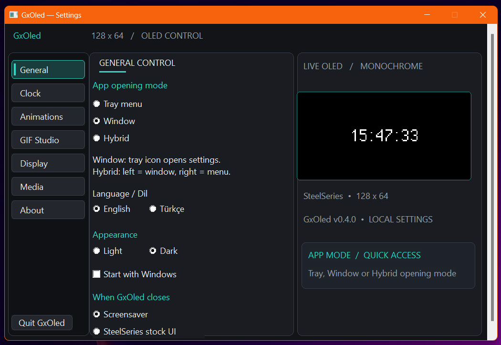

# GxOled Advanced

**An unofficial OLED control panel for compatible SteelSeries base stations.**  
Clock styles, burn-in mitigation, SteelClock-Go animations, GIF playback, brightness controls, and a native Windows settings window — built on [JerwuQu/ggoled](https://github.com/JerwuQu/ggoled).

<p align="center">
  
</p>

<p align="center">
  <a href="https://github.com/MehmetNY/GxOled-Steelseries-Dac-Oled-Control-Panel/releases/tag/v0.5.1"><strong>Download GxOled Advanced v0.5.1</strong></a>
  &nbsp;·&nbsp;
  <a href="#features">Features</a>
  &nbsp;·&nbsp;
  <a href="#screenshots">Screenshots</a>
  &nbsp;·&nbsp;
  <a href="#developers--ai-agents">Developer guide</a>
</p>

> **Current release:** v0.5.1 is the **original-layout** Windows build with the DAC volume-OSD handoff correction. The GIF Studio page currently offers GIF selection and playback; a multi-layer GIF editor is **in development**, not part of this stable release. The application is unofficial and not affiliated with SteelSeries.

## Features

- **Clock gallery** — digital standard/large, round/square analog, and Casio-inspired digital dial; a live 128 × 64 OLED preview.
- **OLED burn-in mitigation** — an independent screen shifter plus clock-specific **Random Movements** and **No overlapping Pixels** modes. These distribute static pixel usage; they **do not guarantee** that burn-in cannot occur.
- **SteelClock-Go animations** — **Matrix Rain**, **Hyperspace**, **Star Wars Intro**, and **Game of Life**, including editable/importable/exportable 128 × 64 JSON profiles. The original Go renderer runs as a helper; GxOled retains control of the USB/OLED connection.
- **GIF playback & GIF Studio tab** — choose a GIF and start/stop its playback. A richer editor inspired by [GGIF-Studio](https://github.com/D4rkTT/GGIF-Studio) (timeline, layers, transforms, dithering) is planned and **not yet available** in v0.5.0.
- **Display & daily controls** — device brightness levels 1–10, idle screensaver/stock display behavior, native volume overlay cooperation, and optional media information.
- **Native Windows settings** — original dark/light interface, English/Türkçe, Tray/Window/Hybrid modes, optional Windows startup, and saved preferences.

## Screenshots

The original Windows layout is pictured above. More screenshots from this project's existing gallery:

<table>
  <tr>
    <td align="center"><a href="https://github.com/user-attachments/assets/08087e53-ac59-4d96-aae2-86bff951c585"></a></td>
    <td align="center"><a href="https://github.com/user-attachments/assets/fb2c1cee-2b0d-46e3-b5f1-37fb7fe9b70e"></a></td>
    <td align="center"><a href="https://github.com/user-attachments/assets/e9859914-d039-4977-921e-a2932d05d144"></a></td>
  </tr>
  <tr>
    <td align="center"><a href="https://github.com/user-attachments/assets/6509c9bb-7f34-4ff1-be66-3aa4269433f9"></a></td>
    <td align="center"><a href="https://github.com/user-attachments/assets/00c89698-fb6e-40c8-aa4c-09924e6991c4"></a></td>
    <td align="center"><a href="https://github.com/user-attachments/assets/3a29fcb3-6db1-45e6-bc81-ceef59a82684"></a></td>
  </tr>
</table>

## Get started

1. Download the [**v0.5.0 Windows release**](https://github.com/MehmetNY/GxOled-Steelseries-Dac-Oled-Control-Panel/releases/tag/v0.5.1) (`gxoled.exe` or Windows ZIP).
2. Connect a supported **SteelSeries base station** over USB and run GxOled.
3. Open **Settings** (using the tray icon or the configured window mode). Select **Clock**, **Animations**, **GIF Studio**, or **Display**.
4. Use **Display → Clock burn-in protection** for clock movement, and **Display → OLED screen shift** for whole-screen shifting.

**Compatibility:** the code identifies Arctis Nova Pro **Wired** (`12CB`, `12CD`) and **Wireless** (`12E0`, `12E5`, `225D`) base stations. Nova Elite (`2244`) is experimental and not hardware-verified here. These IDs are USB **product IDs**, not a promise of universal SteelSeries compatibility. Windows is the primary tested desktop target; Linux/macOS sources exist but are not equivalent to a verified Windows release.

**Türkçe kısa bilgi:** Saat, GIF ve animasyon seçeneklerini Windows ayar penceresinden yönetebilirsiniz. Yanık izi koruması riski azaltır, tamamen ortadan kaldırmaz. Ayrıntılı geliştirme bilgileri aşağıdadır.

## Developers & AI agents

The sections below are intentionally collapsed for everyday users. They are **source-oriented tutorials**, not promises that unreleased features already work. Development contributions are welcome; protect the stable UI and review changes against the actual device protocol.

<details>
<summary><strong>1. Architecture, module map and single-owner OLED pipeline</strong></summary>

GxOled combines a Rust device backend, an SDL3/tray application, a native Win32 settings window, and an embedded Go animation process:

| Location | Purpose |
|---|---|
| `gxoled_lib/src/` | HID discovery, USB product IDs, report packing and device I/O |
| `gxoled_draw/src/` | One-bit frame composition, GIF decoding, clocks, OLED screen shifting |
| `gxoled_draw/src/casio.rs` | Casio-inspired 128 × 64 clock rendering |
| `gxoled_app/src/main.rs` | Settings/configuration, tray events, clocks and animation state |
| `gxoled_app/src/settings_window.rs` | **Original** native Windows settings UI — preserve its layout |
| `gxoled_app/src/go_bridge.rs` | Starts the Go helper and consumes raw monochrome frames |
| `go_animations/internal/widget/` | Four upstream-derived SteelClock-Go animation implementations |
| `go_animations/cmd/renderer/` | Headless Go process and embedded default animation profiles |
| `gxoled_cli/src/main.rs` | Standalone command-line controls |

**Frame ownership:** Go renders `128 × 64` single-bit frames (1,024 bytes, MSB-first). Rust receives those frames and is the **only component** that writes to the base station via USB/HID. The Go helper does not contact the device or GameSense. Do not add a second simultaneous OLED writer.

**Third-party provenance:** the app is derived from [JerwuQu/ggoled](https://github.com/JerwuQu/ggoled); the four Go widgets and supporting code derive from [pozitronik/steelclock-go](https://github.com/pozitronik/steelclock-go) (see [`go_animations/UPSTREAM.md`](go_animations/UPSTREAM.md)). [D4rkTT/GGIF-Studio](https://github.com/D4rkTT/GGIF-Studio) is **inspiration for future editing features**, not a bundled Electron UI. Preserve licenses and attribution.

</details>

<details>
<summary><strong>2. Build and test on Windows (Rust + optional Go)</strong></summary>

Prerequisites: current Rust toolchain with `cargo`, Visual Studio C++ build tools, and CMake/SDL3 build requirements. Use a **short checkout path** such as `C:\gx` to avoid deeply nested Windows/CMake paths. Build from the repository root:

```powershell
cargo check --locked -p gxoled_app --features sdl3-static
cargo test --locked -p gxoled_app -p gxoled_lib -p gxoled_draw --features gxoled_app/sdl3-static
cargo build --locked --release -p gxoled_app --features sdl3-static
```

The desktop executable is `target\release\gxoled.exe`, **not** automatically `release\gxoled.exe`. On Windows you can also invoke `Validate-Windows.cmd` for check → tests → build. The CLI can be built separately:

```powershell
cargo build --locked --release -p gxoled_cli
```

**Go renderer:** `go_animations/gxoled-animations.exe` is embedded at compile time using `include_bytes!`. The stable source contains this helper; do not delete it as “build junk”. When changing Go widget code, regenerate it **before** building the Rust app:

```powershell
cd go_animations
go test ./...
go build -trimpath -ldflags="-s -w" -o gxoled-animations.exe ./cmd/renderer
cd ..
cargo build --locked --release -p gxoled_app --features sdl3-static
```

Go 1.23+ is required by `go_animations/go.mod` when rebuilding the helper. Avoid replacing the embedded helper without testing 128 × 64 frames and app startup. A successful compile does **not** validate physical OLED hardware.

</details>

<details>
<summary><strong>3. Animation profiles — JSON tutorial and validation rules</strong></summary>

The built-in presets are in [`go_animations/profiles/128x64/`](go_animations/profiles/128x64/) and the embedded renderer copies are in [`go_animations/cmd/renderer/profiles/`](go_animations/cmd/renderer/profiles/). Supported widget types: `matrix`, `hyperspace`, `starwars_intro`, `game_of_life`.

To make a custom animation profile in the Windows interface:

1. Open **Animations**, choose one of the four engines and select **New Profile**, **Import** or **Edit**.
2. For a new profile, use **Reset** in the JSON editor to populate a valid default template.
3. Change settings for that widget only; save/apply the configuration and select the profile.
4. Export the profile before experimenting with complex changes.

The validator expects exactly **one widget**, display dimensions **128 × 64**, `refresh_rate_ms` from **10 to 1000**, and a type compatible with the selected engine. The profile is limited to **64 KiB**. For example, start from the complete [Matrix JSON profile](go_animations/profiles/128x64/matrix.json) rather than inventing required nested fields. Custom profiles are stored in `%APPDATA%\GxOled\profiles\custom\` on typical Windows installations.

Preserve both profile-copy locations when you edit built-in defaults; `//go:embed` compiles the renderer's copies into its EXE. Test with `cd go_animations; go test ./...` and then rebuild the helper.

</details>

<details>
<summary><strong>4. Burn-in controls, GIF playback and configuration behavior</strong></summary>

**Two separate shift mechanisms:**

- **OLED screen shift:** Off/Low/High applies a small translation during frame composition. The drawing module advances this on a roughly **90-second** cycle.
- **Clock burn-in protection:** Off / **Random Movements** / **No overlapping Pixels** selects clock placement strategies, normally updated at minute boundaries. The second mode aims to reduce consecutive clock pixel overlap; the actual available space limits any guarantee. The Casio-inspired full-screen clock does not use the clock-specific repositioning, although the independent OLED shifter can still apply.

OLED protection **reduces risk**, not panel wear. Avoid leaving static imagery at high brightness indefinitely.

**GIF Studio in v0.5.0:** provides **Add GIF...** and **Start / Stop GIF** using the existing playback engine. It is not yet a layer editor, video editor, trim timeline, or image-compositing workflow. Keep development claims separate from release claims. The application already bounds image size, frame count and decoded pixels for safety.

**Configuration:** on Windows settings normally reside at `%APPDATA%\GxOled\config.toml` and are persisted between launches. Keep backwards compatibility for existing serialized enum variants and stored paths. Windows startup registration belongs to the current user rather than a system-wide installation. Device brightness uses protocol steps 1–10, which are not calibrated percentages.

</details>

<details>
<summary><strong>5. AI agent / contributor checklist — preserve the original UI</strong></summary>

1. Read this README, [`CHANGELOG.md`](CHANGELOG.md), [`go_animations/UPSTREAM.md`](go_animations/UPSTREAM.md), then the target module. Establish whether a feature exists in **stable v0.5.0** before changing documentation.
2. Use `v0.5.0` as the immutable release reference. Keep experiments on a separate feature branch. **Do not edit or redesign** the original Windows settings window merely to add a feature.
3. The intended stable window uses **GENERAL CONTROL**, **CLOCK GALLERY**, and **LIVE OLED / MONOCHROME**; it is not the experimental card-grid **OLED CONTROL CENTER** layout. The reference screenshot is [`docs/images/gxoled-advanced-main.png`](docs/images/gxoled-advanced-main.png).
4. Preserve the Rust HID ownership model, 128 × 64 output dimensions, configuration compatibility, and licensing notices. Do not remove `go_animations/gxoled-animations.exe` while Rust embeds it.
5. For changes to display or animations, run the Rust checks/tests/build and the applicable Go tests. Manually validate Win32 controls, tray behavior, live preview, reconnect, GIF timing, and the base station when hardware is available.
6. Record validation honestly: **compiled**, **unit-tested**, and **verified on a physical base station** are different statuses. Prefer reproducible focused commits, explain UI deltas, and publish development previews separately from stable tags.
7. Review security and dependency updates (`cargo audit` when installed). Do not import a whole Electron/GameSense client into the HID app without an explicit architectural decision, a license review and a testable integration path.

</details>

<details>
<summary><strong>6. Linux/CLI and alternative workflows</strong></summary>

The CLI remains available for direct commands:

```sh
gxoled-cli --help
gxoled-cli brightness 1
gxoled-cli text "Hello, World!"
gxoled-cli img image.png
gxoled-cli anim animation.gif
```

For direct USB permissions on Linux, review [`11-steelseries-arctis-nova.rules`](11-steelseries-arctis-nova.rules). A Flatpak manifest and systemd user service are provided under [`flatpak/`](flatpak/) and [`gxoled.service`](gxoled.service), but they require platform-specific packaging and testing. A prebuilt Linux or macOS binary is not promised by the Windows v0.5.0 release.

</details>

## Credits & license

This is an **unofficial** GPL-3.0 derivative, not an official SteelSeries product. Its core originates in **[JerwuQu/ggoled](https://github.com/JerwuQu/ggoled)**; the integrated animation algorithms come from **[pozitronik/steelclock-go](https://github.com/pozitronik/steelclock-go)**. Future GIF editor concepts refer to **[D4rkTT/GGIF-Studio](https://github.com/D4rkTT/GGIF-Studio)**. All names belong to their respective owners. See [`LICENSE`](LICENSE) and upstream notices for redistribution obligations.

Project development has involved maintainer-led changes and AI-assisted coding/review. Contributions, bug reports and reproducible hardware findings are welcome.